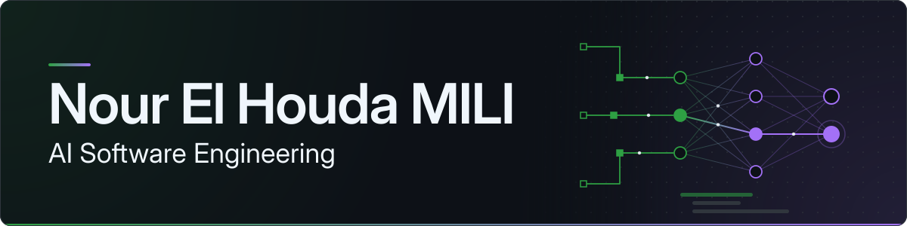

**AI Software Engineering | Python Backend | Applied Machine Learning**

Computer Science graduate and Master's student in Artificial Intelligence, building full-stack applications with Python, FastAPI and React.

 

##  About

I'm most interested in the engineering around AI: dependable backends, careful handling of real data, and verifying that a system behaves the way it claims to. The projects below are early-career work, and each one states what works and what is still in progress.

##  Featured projects

<table width="100%">
<tr>
<th width="64" align="center"></th>
<th align="left">Shopper Signals</th>
</tr>
<tr>
<td colspan="2">
Analytics dashboard over a 100,000-event sample of the Kaggle eCommerce behavior dataset. Import script with dry-run mode and safe re-runs; exact duplicates collapsed, zero-price rows flagged. Google sign-in with server-side admin roles. pytest suite for import, analytics and API auth. 

 
<b>Status:</b> runs locally with documented setup. Some planned components and app-created orders are not implemented. No live demo. 
<b>Repository:</b> <a href="https://github.com/n00rElh00da/ecommerce-analytics-dashboard">ecommerce-analytics-dashboard</a>
</td>
</tr>
</table>

<table width="100%">
<tr>
<th width="64" align="center"></th>
<th align="left">Tailorina</th>
</tr>
<tr>
<td colspan="2">
Web application exploring vision AI to help customers describe garments to tailors. Intended flow: a customer uploads a garment image, the React frontend sends it to a FastAPI backend, and the Google Gemini API analyzes it to return garment information. 

 
<b>Status:</b> early-stage MVP. The upload and analysis interface is deployed; the backend and AI analysis workflow are in development, and frontend-backend integration is not finished. Planned, not built: price estimation, tailor matching, customer and tailor profiles. 
<b>Repository:</b> <a href="https://github.com/n00rElh00da/Tailorina">Tailorina</a>
</td>
</tr>
</table>

<table width="100%">
<tr>
<th width="64" align="center"></th>
<th align="left">Migration-Proof</th>
</tr>
<tr>
<td colspan="2">
Behavioral verification for SQLite to PostgreSQL migrations, built for the IBM Bob 2.0 hackathon (LabLab). A migration can pass every structural check and still change behavior, such as <code>LIKE</code> case-sensitivity or <code>NULL</code> ordering. An independent oracle runs the same application queries on both databases, classifies each difference with a counterexample, withholds test cases from the AI repair agent, and includes a mutation test showing the verifier can fail a bad migration. 

 
<b>Status:</b> hackathon prototype. The oracle, comparator, held-out cases and mutation test are implemented and exercised on the SQLite side and with synthetic comparisons. Certified results from a live PostgreSQL run are not yet published in the repository. 
<!-- UPDATE the status above after committing artifacts/verification.json, certificate.json and mutation-report.json from a real PostgreSQL run. -->
<b>Repository:</b> <a href="https://github.com/n00rElh00da/Migration-Proof">Migration-Proof</a> | <a href="https://github.com/n00rElh00da/Migration-Proof/blob/master/migration-proof.drawio.png">workflow diagram</a>
</td>
</tr>
</table>

##  Technical skills

<table>
<tr>
<th align="left">Area</th>
<th align="left">Technologies</th>
</tr>
<tr>
<td>Languages</td>
<td>

 
Foundations: C, Java
</td>
</tr>
<tr>
<td>Backend and APIs</td>
<td>

 
Foundations: software architecture
</td>
</tr>
<tr>
<td>Frontend</td>
<td>

 
Foundations: HTML5, CSS3, Tailwind CSS, Figma
</td>
</tr>
<tr>
<td>Databases</td>
<td>

 
Foundations: MySQL, database design
</td>
</tr>
<tr>
<td>AI and data</td>
<td>
 
Studying: machine learning, PyTorch, NumPy, Pandas
</td>
</tr>
<tr>
<td>Testing</td>
<td>

 
Foundations: software testing
</td>
</tr>
<tr>
<td>Tools</td>
<td>

 
Foundations: Linux, VS Code
</td>
</tr>
<tr>
<td>CS foundations</td>
<td>Object-oriented programming, data structures and algorithms</td>
</tr>
<tr>
<td colspan="2">Badges show technologies used in the projects above. Smaller text under each row lists foundations and areas of active study.</td>
</tr>
</table>

##  Current learning

- Machine learning fundamentals and PyTorch, alongside my Master's coursework.
- Integrating vision and language model APIs into backends that stay reliable when the model output is not.
- Testing and verification, especially for AI-generated or automatically migrated code.
- Backend architecture, data validation and database design.
- **TreeLab** (planning and prototype stage, not published here yet): an interactive platform for running machine learning experiments across multiple datasets.

##  Contact

Open to internships and junior roles, including international remote positions. The best way to reach me is [LinkedIn](https://linkedin.com/in/n00relh00da) or [email](mailto:noure4257@gmail.com).